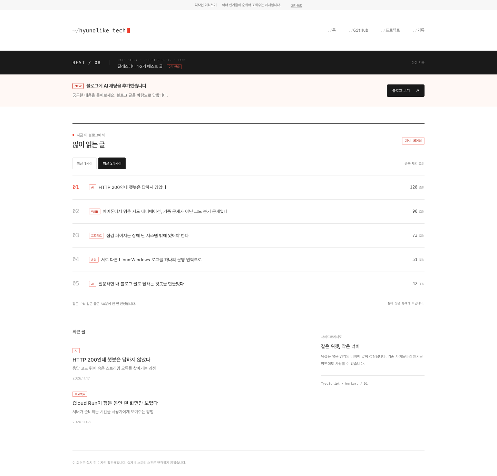

# Tistory live ranking

[hyunolike tech](https://hyunolike.tistory.com/)에 넣는 실시간 인기글 위젯입니다. 최근 1시간과 24시간 동안 많이 읽힌 글 5개를 보여줍니다. 기존 스킨의 붉은 강조색, 모노스페이스 숫자, 얇은 테두리를 따르고 Shadow DOM으로 CSS를 분리했습니다.



[모바일 미리보기](docs/images/preview-390.png) · [320px 미리보기](docs/images/preview-320.png)

## 운영 주소

- [디자인 미리보기](https://tistory-live-ranking.tistory-live-ranking.workers.dev/): 순위와 조회수는 예시입니다.
- [실제 API 결과](https://tistory-live-ranking.tistory-live-ranking.workers.dev/?live=1): 운영 집계입니다. 이 화면 자체는 조회를 수집하지 않습니다.
- [한 번에 붙여 넣는 설치 코드](examples/install.html)

공개 저장소이며 운영 Worker와 D1을 배포했습니다. 실제 티스토리 스킨 적용은 Chrome 공유 조작 확인 후 진행합니다. 적용 전까지 운영 목록은 비어 있을 수 있습니다.

## 동작

- TypeScript 웹 컴포넌트가 `/widget.js` 하나로 로드됩니다.
- Cloudflare Workers가 API와 정적 파일을 제공하고 D1에 조회를 저장합니다.
- 순위 기준은 **30분 중복 제외 조회**입니다. 같은 IP가 같은 글을 새로고침해도 30분 동안 한 번만 반영합니다.
- 기본 최근 24시간, 선택 최근 1시간, 60초마다 갱신합니다. 숨긴 탭에서는 갱신을 멈춥니다.
- 홈, 검색, 공지, 미등록 글, 보호글은 집계하지 않습니다. 읽기 API는 검증한 글 제목과 URL만 제공합니다.
- 카탈로그는 매시간 sitemap을 확인하고 검증이 오래된 글 10개를 다시 확인합니다. 24시간 이상 확인하지 못한 글은 집계와 표시에서 제외합니다.
- 첫 화면은 **예시 데이터로 만든 디자인 미리보기**입니다. 실제 통계를 수집하거나 운영 랭킹으로 표시하지 않습니다.

## 로컬 개발

Node.js 22.12 이상, pnpm 10.17을 사용합니다. 로컬 실행에는 Cloudflare 계정이 필요하지 않습니다.

```sh
git clone https://github.com/hyunolike/tistory-live-ranking.git
cd tistory-live-ranking
pnpm install --frozen-lockfile
cp .dev.vars.example .dev.vars
pnpm db:migrate
pnpm catalog:sync
pnpm db:seed
pnpm dev
```

http://localhost:8787 에서 디자인을 확인합니다. `/?live=1`은 실제 **로컬** API 결과를 보여줍니다. 이 URL도 조회 수집은 하지 않습니다.

카탈로그 동기화는 공개 sitemap과 글 HTML을 읽어 제목, 고유 주소, 공개 본문 유무만 확인합니다. 원문 전체와 티스토리 조회수는 저장하지 않습니다. 초기 카탈로그는 시간이 지나면 만료되므로 새 환경에서는 동기화 후 seed를 실행하세요.

```sh
pnpm typecheck
pnpm test
pnpm build
pnpm exec playwright install chromium
pnpm test:e2e
```

`pnpm test`는 실제 로컬 D1로 API를 검사합니다. 브라우저 검사는 실패, 빈 결과, 기간 변경, 중복 로더, 숨긴 탭, 모바일과 CSS 격리를 확인합니다. 오류 응답을 재현하는 브라우저 테스트는 네트워크 경계만 대체합니다. `pnpm build`는 dry-run이며 배포하지 않습니다.

## API

| 요청 | 결과 |
| --- | --- |
| `GET /health` | 프로세스 응답 확인 |
| `GET /api/rankings?window=24h` | 최근 24시간 TOP 5 |
| `GET /api/rankings?window=1h` | 최근 1시간 TOP 5 |
| `POST /api/views` | JSON `{ "postId": "81" }`, 성공/중복 모두 202 |

수집은 허용된 블로그 origin에서만 요청할 수 있습니다. 로컬 개발 모드에서는 동일 로컬 origin도 허용합니다. 분당 같은 IP의 30건을 넘으면 429입니다. IP는 매일 바뀌는 HMAC 지문으로만 저장하며 원본 IP는 저장하지 않습니다.

## 운영 배포 준비

운영 배포는 완료했습니다. [배포 기록](docs/features/live-ranking/deployment.md)에 버전과 검증 내용을 남겼습니다. 다른 Cloudflare 계정에 새로 배포할 때는 아래 단계에서 자신의 DB ID와 비밀값을 설정하세요.

1. `pnpm exec wrangler login`과 `pnpm exec wrangler d1 create tistory-live-ranking`으로 운영 DB를 만듭니다.
2. `wrangler.jsonc`의 `database_id`를 실제 ID로, `ENVIRONMENT`를 `production`으로 바꿉니다.
3. `pnpm exec wrangler secret put DEDUP_SECRET`에 충분히 긴 임의의 비밀값을 등록합니다. `.dev.vars.example`의 값을 운영에 재사용하지 마세요.
4. `pnpm exec wrangler d1 migrations apply DB --remote`를 실행합니다.
5. `pnpm catalog:sync` 후 `pnpm exec wrangler d1 execute DB --remote --file data/catalog.sql`로 공개 글 카탈로그를 반영합니다.
6. 검증을 통과한 뒤 `pnpm run deploy`를 실행합니다. 개발 모드나 가짜 DB ID가 남아 있으면 이 스크립트는 중단합니다. pnpm의 예약 명령인 `pnpm deploy`와 구분합니다.
7. 공개 `/health`, 랭킹 JSON, JavaScript MIME와 CORS를 확인한 뒤 설치합니다. 운영에서 비밀키가 누락되면 수집 API는 503을 반환합니다.

GitHub Actions는 검증만 수행하며 배포하지 않습니다. 공개 저장소 전환 후 [원격 검증도 통과](https://github.com/hyunolike/tistory-live-ranking/actions/runs/45401790601)했습니다. 무료 제공량과 초과 요금은 배포 시점의 Cloudflare 계정에서 확인하세요.

## 티스토리 설치

스킨을 백업하고 다음 조각만 추가합니다. 스킨 전체를 덮어쓰지 않습니다.

- **상단:** [top-band.html](examples/top-band.html)을 AI 채팅 공지 스크립트 뒤, `[##_revenue_list_upper_##]` 앞에 넣습니다. [top-band.css](examples/top-band.css)는 `style.css` 맨 아래에 추가합니다.
- **사이드바:** [sidebar.html](examples/sidebar.html)을 별도 사이드바 모듈로 추가합니다. 300px 영역에도 맞춰집니다.
- 예시에는 실제 운영 주소가 들어 있습니다. 한 파일로 추가하려면 [install.html](examples/install.html)을 지정한 위치에 붙여 넣습니다. 여러 삽입 예시를 함께 사용할 때 `widget.js`는 한 번만 넣습니다.
- 표시 영역을 홈에만 넣더라도 **수집 스크립트는 모든 공개 글에서 실행**되어야 합니다. 실제 공개 글에서 `/api/views`의 202를 확인하세요.
- 티스토리의 **모바일웹 자동 연결을 해제**해 사용자 스킨을 사용합니다. 직접 `/m/글번호`로 들어가 기본 모바일웹을 쓰면 로더 실행과 집계를 지원하지 않습니다.
- 선정 기록, 프로젝트 메뉴, AI 채팅과 기존 사이드바 목록은 그대로 둡니다. 문제 발생 시 추가한 HTML/CSS/script 조각을 제거하면 됩니다.

```html
<blog-live-ranking api-base="https://tistory-live-ranking.tistory-live-ranking.workers.dev"></blog-live-ranking>
<script src="https://tistory-live-ranking.tistory-live-ranking.workers.dev/widget.js" defer></script>
```

색상은 컴포넌트의 CSS 변수 `--ranking-accent`, `--ranking-text`, `--ranking-muted`, `--ranking-border`로 조정할 수 있습니다. 수집을 끄고 디자인만 볼 때는 컴포넌트에 `demo`, 로더에 `data-track="false"`를 각각 지정합니다.

## 수치의 의미와 운영 한계

집계 설치 이후의 데이터이며 티스토리 통계와 다를 수 있습니다. 같은 공인 IP를 쓰는 독자는 중복으로 처리될 수 있습니다. UTC 일자 경계에서 지문이 바뀌므로 그 시점에는 중복 기준이 초기화됩니다. 실제 고유 방문자나 동시 접속자를 뜻하지 않습니다.

Origin 검사는 인증이 아니며 공개 수집 API의 고의적 조작과 자동 브라우저를 완전히 차단하지 못합니다. 삭제나 보호 전환은 카탈로그의 다음 확인 때 반영되며 즉시 반영을 보장하지 않습니다. 조회 이벤트는 7일 동안 보관하고 정리합니다.

브라우저 스크립트를 차단하거나 기본 모바일웹을 사용하는 방문은 집계에서 빠질 수 있습니다. 운영 배포, 실제 스킨, Safari/iOS 실기기의 결과는 로컬 Chromium 검사와 구분합니다.

## 개발 문서

- [요구사항](docs/features/live-ranking/spec.md)
- [설계](docs/features/live-ranking/design.md)
- [작업 목록](docs/features/live-ranking/tasks.md)
- [독립 설계 검토](docs/features/live-ranking/reviews/2026-11-24-design-check.md)
- [독립 코드 검토와 수정](docs/features/live-ranking/reviews/2026-11-24-code-review.md)
- [검증 기록](docs/features/live-ranking/verification.md)

